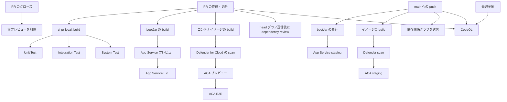

# この数字、なんの数字？

金融・公共のお客様向けデモ用クイズアプリケーションです。

## 技術スタック

- **言語**: Java 21（LTS）
- **フレームワーク**: Spring Boot 3.4 + Thymeleaf（SSR）
- **フロントエンド**: Bootstrap 5（CDN）
- **データ管理**: JSON ファイル（起動時ロード）
- **ビルドツール**: Gradle（Kotlin DSL）

## 前提条件

- Java 21 以上

## ビルド・実行

```bash
# ビルド（Unit Test + Integration Test を含む）
./gradlew :app:build

# アプリケーション起動
./gradlew :app:bootRun
```

ブラウザで http://localhost:8080 にアクセスしてください。

## テスト

```bash
# Unit Test
./gradlew :app:test

# Integration Test
./gradlew :app:integrationTest

# System Test（事前にアプリケーション起動が必要）
./gradlew :system-test:test

# カバレッジレポート（Unit + Integration）
./gradlew :app:jacocoFullReport
```

## プロジェクト構成

Gradle マルチプロジェクト構成（モノレポ）を採用しています。

```
├── app/                       ... メインアプリケーション
│   ├── build.gradle.kts
│   └── src/
│       ├── main/
│       │   ├── java/com/example/quiz/
│       │   │   ├── controller/    ... Controller 層
│       │   │   ├── service/       ... Service 層
│       │   │   ├── model/         ... データモデル（Record）
│       │   │   └── dataloader/    ... データロード
│       │   └── resources/
│       │       ├── templates/     ... Thymeleaf テンプレート
│       │       ├── static/css/    ... スタイルシート
│       │       └── data/          ... クイズデータ JSON
│       ├── test/                  ... Unit Test
│       └── integrationTest/       ... Integration Test
├── system-test/                   ... System Test（独立サブプロジェクト）
│   ├── build.gradle.kts
│   └── src/test/                  ... Playwright + JUnit 5
├── docs/                          ... ドキュメント
├── Dockerfile                     ... アプリのコンテナイメージ定義
├── build.gradle.kts               ... ルートプロジェクト
└── settings.gradle.kts            ... サブプロジェクト定義
```

## AI エージェント向け設定（Skill 中心）

AI コーディングエージェント向けの手順的知識は **Agent Skill** として部品化し、
ローカル Skill と外部 Azure Skill は **Agent Plugin** として管理しています。
設計の詳細は
[docs/design/agent-design.md](docs/design/agent-design.md) を参照してください。

- ローカル Skill のソース: `plugins/what-number/skills/`（Agent Plugins 1.0）
- Plugin marketplace: `.github/plugin/marketplace.json`。`.github/copilot/settings.json` で marketplace と既定 Plugin を GitHub Copilot に設定
- 外部 Azure Plugin: `microsoft/azure-skills` の `.github/plugins/azure-skills` を remote plugin として登録し、`main` の commit SHA と manifest version を marketplace に固定
- Azure Plugin には Skill に加えて Azure MCP と telemetry hooks が含まれる。利用には Node.js 18 以上が必要で、Azure 操作には Azure CLI の認証が必要。telemetry は `AZURE_MCP_COLLECT_TELEMETRY=false` で無効化できる
- ローカル Skill の追加・変更は Plugin の `skills/` 以下で行い、Plugin の version と marketplace の version を合わせる
- Azure Plugin の更新時は upstream `main` の最新 commit SHA と `.plugin/plugin.json` の version を確認し、marketplace entry を同時に更新する

## コンテナ実行

アプリは Spring Boot 実行可能 JAR をマルチステージビルドでコンテナ化しています。

```bash
# イメージのビルド
docker build -t quiz-app .

# コンテナの起動
docker run --rm -p 8080:8080 quiz-app
```

ブラウザで http://localhost:8080 にアクセスしてください。

## CI/CD（GitHub Actions + Azure Container Apps / App Service）

PR ごとに専用のプレビュー環境を **2 種類の Azure ホスティング**（Azure Container Apps と Azure App Service）へ
並行作成し、それぞれ **PR 固有の URL** で公開します。
デプロイ後、各 URL に対して E2E（Playwright System Test）を自動実行します。

### ワークフロー一覧

| ワークフロー | 種別 | トリガー | デプロイ先 | 内容 |
|---|---|---|---|---|
| `ci-pr-local.yml` | CI | PR (main): open / synchronize / reopen | なし（ローカル） | Build の後に Unit / Integration / System Test を並行実行。System Test はランナー内でアプリを起動して検証 |
| `ci-pr-remote.yml` | CI | PR (main): open / synchronize / reopen / close | PR 専用プレビュー環境（固有 URL） | PR ごとに **Container App**（コンテナ）と **App Service Web App**（Java SE 21 / bootJar）を並行作成 → 各固有 URL でデプロイ → E2E 実行 → URL を PR にコメント。クローズ時に両方を削除 |
| `cd-merge.yml` | CD | push (main)（= マージ） / 手動 | ステージング環境 | bootJar を Azure Artifacts と GitHub Packages（Maven）へ発行し、**ACA** と **App Service** の 2 つのステージング環境へ並行デプロイ。各環境で HTTP 200 を確認 |
| `cd-release.yml` | CD | 手動（`workflow_dispatch`、版を手入力） | － | バージョン検証とビルド・テスト後、リリースコミットにタグを付けて Maven / ACR へ発行し、GitHub Release を作成。その後、次期開発版へ戻すコミットを作成。ACA / App Service へはデプロイしない |
| `infra-bootstrap.yml` | セットアップ | 手動（`workflow_dispatch`） | － | 初回セットアップ用にリソースグループ・ACR・マネージド ID・ACA 環境・App Service プランを作成 |
| `ttl-cleanup.yml` | 運用 | 15 分毎 / 手動 | － | TTL 期限切れ（最終 push から 1 時間）のプレビュー環境（Container App / Web App）を削除 |
| `dependency-submission.yml` | 依存関係 | push (main) / 手動 | － | Gradle の依存関係グラフを GitHub Dependency Graph へ送信 |
| `dependency-review.yml` | 依存関係 | PR (main): open / synchronize / reopen | － | PR の head グラフを送信してから base との差分を確認し、中程度以上の脆弱性があれば失敗 |
| `codeql.yml` | セキュリティ | push (main) / PR (main) / 毎週金曜 02:18 UTC | － | CodeQL で GitHub Actions と Java を解析。現在の Java `autobuild` 設定は Kotlin を解析しない |

### ワークフローの関係

PR のローカルテストと Azure プレビュー検証は別のワークフローで実行します。ローカル CI は build 後に3種類のテストを並列実行します。プレビュー CI は jar とコンテナイメージを別々に準備し、それぞれの環境にデプロイして E2E を実行します。



`cd-merge.yml` では jar とイメージを並行して作ります。App Service は jar を受け取り、ACA は Defender のスキャンに通ったイメージを受け取ります。スキャンが失敗すると ACA のデプロイへ進みません。

`ci-pr-remote.yml` の各 E2E ジョブは、失敗してもスクリーンショットとテストレポートを Actions の成果物に保存し、対象環境の URL と結果を PR にコメントします。

`dependency-submission.yml` は `main` の依存関係グラフを更新します。`dependency-review.yml` は PR の head グラフを送信してから base との差分を評価します。head グラフの送信がレビューより先に必要なため、両方を PR ワークフロー内で順に実行します。

### ワークフローの設計上の理由

- PR ごとのローカル CI は Azure に接続せず、アプリのテストを実行します。プレビュー CI は ACA と App Service のデプロイ設定を別々に検証します。
- ACA のイメージスキャンは Defender for Cloud CLI で SARIF と CycloneDX SBOM を生成します。SBOM は OS と言語の識別に使います。`sarif-dockerfile-anchor` はイメージ参照で報告された脆弱性を Dockerfile の行に対応付け、Code Scanning で PR の差分に注釈します。
- GitHub-hosted runner の Azure CLI ランタイム一覧が Java 21 を認識しない場合、ワークフローは Java 11 で Web App を作成し、`linux-fx-version` を Java 21 に設定します。この手順は作成時のランタイム指定に対する回避策です。
- App Service プランは Web App がなくなると削除される場合があります。`cd-merge.yml` はデプロイ前にプランを確認し、存在しない場合は再作成します。
- プレビュー環境には最後の PR 更新から1時間後の `TTLExpire` タグを付けます。`ttl-cleanup.yml` は15分ごとにタグを確認し、期限切れの Container App と Web App を削除します。PR のクローズ時は `ci-pr-remote.yml` が両方をすぐ削除します。
- `infra-bootstrap.yml` は既存の ACR、マネージド ID、ACA 環境、App Service プランを再利用します。マネージド ID への ACR Pull ロール割り当てでは、Microsoft Entra ID への反映を待って10秒間隔で最大6回再試行します。
- `cd-release.yml` はリリース版と次期開発版の2コミットを作成します。タグ `v<release_version>` はリリースコミットに付きます。次期開発版への更新コミットはその後に作成し、本番環境へのデプロイは行いません。

### PR ごとの URL の仕組み

App Service のデプロイスロットに相当する仕組みとして、PR ごとに独立したプレビュー環境を作成します。

- **Azure Container Apps**: 共有 ACA 環境内に Container App
  （`<AZURE_CONTAINERAPP_NAME>-pr-<PR番号>`）を作成。各 Container App は固有の Ingress FQDN を持つ。
- **Azure App Service**: 共有 App Service プラン上に Web App
  （`<APP_SERVICE_WEBAPP_PREFIX>-pr-<PR番号>`）を作成。`*.azurewebsites.net` の固有 FQDN を持つ。

いずれも PR 単位で URL が分離され、PR クローズ時または TTL 期限切れで自動削除されます。

### マージ時のステージングデプロイ（`cd-merge.yml`）

`main` への push（PR マージ）または手動実行で、以下を行います（リリース時に本番 prod へ展開する想定）。

- **Java 成果物の発行**: `bootJar` を 2 つの Maven レジストリへ
  `com.example:what-number:<base-version>-<short-sha>` として発行する。`<base-version>` は `gradle.properties` の `version` から `-SNAPSHOT` を外した値で、`<short-sha>` はコミット SHA の先頭 7 文字。
  - Azure DevOps の **Azure Artifacts**（project スコープフィード）
  - **GitHub Packages**（`maven.pkg.github.com/<owner>/<repo>`、`GITHUB_TOKEN` で認証）
- **ステージングへの並行デプロイ**:
  - Azure Container Apps: `<AZURE_CONTAINERAPP_NAME>-staging`
  - Azure App Service: `<APP_SERVICE_WEBAPP_PREFIX>-staging`（Java SE 21）

各デプロイ後に HTTP 200 を確認するスモークチェックを実行します。

#### 現在のステージングデプロイ先 URL

| ホスティング | URL |
|---|---|
| Azure Container Apps | https://quiz-app-staging.livelycoast-5b8df27f.japaneast.azurecontainerapps.io |
| Azure App Service | https://quiz-app-15679f-staging.azurewebsites.net |

> メモ: App Service プランは空になると自動削除されることがあるため、`cd-merge.yml` の
> `deploy-appservice` ジョブはデプロイ前にプランの存在を確認し、無ければ冪等に再作成します。

### リリース手順（`cd-release.yml`）

バージョン管理は **`gradle.properties` の `version` を単一正本**とし、Java/Gradle の流儀に従います。

- 開発中（`main`）は常に `-SNAPSHOT` 付き（例: `0.0.1-SNAPSHOT`）。
- リリース版は `-SNAPSHOT` を外した不変版（例: `1.0.0`）。

リリースは GitHub Actions の **`cd-release.yml` を手動実行**して行います（**バージョン書き換えを手作業で行わないこと**）。

1. リポジトリ → **Actions → Release → Run workflow** を開く。
2. 入力欄に次を指定して実行する。
   - `release_version`: リリースする版（`-SNAPSHOT` 無し）。例 `1.0.0`
   - `next_dev_version`: 次期開発版（`-SNAPSHOT` 付き）。例 `1.0.1-SNAPSHOT`
3. ワークフローが以下を自動実行する。
   1. 入力検証（リリース版に `-SNAPSHOT` が無いこと／次期開発版に `-SNAPSHOT` が有ること／同名タグ未存在）
   2. `gradle.properties` をリリース版へ書き換え
   3. `:app:build`（Unit + Integration Test）でリリース品質をゲート
   4. **リリースコミット**を作成し、注釈付きタグ `v<release_version>` を**そのコミットに**付与
   5. bootJar を Maven レジストリ（Azure Artifacts / GitHub Packages）へ `<release_version>` で発行
   6. **コンテナイメージを ACR へ発行**（`az acr build`）。タグは `quiz-app:<release_version>` と `quiz-app:latest`
   7. リリースコミットとタグを `main` へ push
   8. **GitHub Release** を作成（リリースノートは自動生成 `--generate-notes`、bootJar を添付）
   9. `gradle.properties` を **次期開発版（`-SNAPSHOT`）へ戻すコミット**を作成し `main` へ push

> タグ `v<release_version>` は手順 4 の「リリースコミット」を指します。手順 9 の「次期開発版コミット」より前に
> 確定するため、タグと版の対応がずれることはありません。
>
> **ACA / App Service への本番デプロイは `cd-release.yml` には含めていません**（承認者が手動で実施する想定）。
> 本ワークフローは成果物（Maven / コンテナイメージ）の発行・タグ付け・リリースノート生成のみを行います。
> 発行されたコンテナイメージ `quiz-app:<release_version>` を承認者が ACA / App Service へ手動デプロイします。
>
> リリースボットのコミットには `[skip ci]` を付与しているため、これらの push で `cd-merge.yml` は起動しません。
>
> `cd-release.yml` は `main` から実行してください。Azure Artifacts 用 OIDC 資格情報は `main` のみを信頼します。
> ブランチ保護で push を禁止している場合は、GitHub Actions アプリに保護のバイパスを許可してください。

### セットアップ手順

1. Azure デプロイ用の Microsoft Entra アプリ登録を作成し、GitHub Actions 用 OIDC フェデレーション資格情報を構成する。
   サービスプリンシパルに `AZURE_DEPLOY_CLIENT_ID` を設定する。
   初回の `infra-bootstrap` 実行には、対象サブスクリプションまたはリソースグループのロール割り当て権限が必要。
   `Owner` または `Contributor` と `User Access Administrator` を付与する。
2. Azure Artifacts 発行専用の Entra アプリ登録を作成し、GitHub Actions 用 OIDC フェデレーション資格情報を追加する。Issuer は `https://token.actions.githubusercontent.com`、Audience は `api://AzureADTokenExchange`、Subject は次の値にする。
   `repo:fuj1g0n-demo@256320378/what-number@1167463052:ref:refs/heads/main`
   このアプリには Azure サブスクリプションのロールを割り当てない。
3. [専用アプリのサービス プリンシパルを Azure DevOps 組織に追加](https://learn.microsoft.com/azure/devops/integrate/get-started/authentication/service-principal-managed-identity)し、無料の **Stakeholder** access level を割り当てる。`what-number` プロジェクトの **Readers** グループに加え、フィードを作成して、そのサービス プリンシパルにフィードの **Contributor** 権限だけを付与する。追加時には Microsoft Entra の **Enterprise applications** にあるサービス プリンシパルの Object ID を使う。
4. Microsoft Defender for Cloud の [GitHub connector を構成](https://learn.microsoft.com/azure/defender-for-cloud/quickstart-onboard-github)する。Defender CLI の image scan はこの connector で認証する。
5. リポジトリ → **Settings → Secrets and variables → Actions → Variables** に以下を登録する。
6. **`infra-bootstrap.yml` を手動実行**して共有インフラ（新規リソースグループ含む）を作成する。
7. 以後、PR を作成すると `ci-pr-remote.yml` が自動的にプレビュー環境をデプロイし、E2E を実行する。

### 必要な GitHub Actions Variables

| 変数名 | 説明 | 例 |
|---|---|---|
| `AZURE_DEPLOY_CLIENT_ID` | Azure デプロイ用 OIDC アプリ登録のクライアント ID | `00000000-0000-...` |
| `AZURE_ARTIFACTS_CLIENT_ID` | Azure Artifacts 専用 OIDC アプリのクライアント ID | `00000000-0000-...` |
| `AZURE_TENANT_ID` | 両方の OIDC アプリが属するテナント ID。`azure/login@v3` のサービスプリンシパル認証で必須 | `00000000-0000-...` |
| `AZURE_SUBSCRIPTION_ID` | サブスクリプション ID | `00000000-0000-...` |
| `AZURE_RESOURCE_GROUP` | 新規作成するリソースグループ名 | `rg-quiz-app` |
| `AZURE_LOCATION` | リージョン | `japaneast` |
| `ACR_NAME` | Azure Container Registry 名（グローバルで一意・英数字のみ） | `quizappacr12345` |
| `ACA_ENVIRONMENT` | Container Apps 環境名 | `cae-quiz-app` |
| `ACR_PULL_IDENTITY_NAME` | ACR Pull 用ユーザー割り当てマネージド ID 名 | `id-quiz-app-acrpull` |
| `AZURE_CONTAINERAPP_NAME` | 本番／プレビューの基底アプリ名（Container Apps） | `quiz-app` |
| `APP_SERVICE_PLAN` | App Service プラン名（Linux） | `asp-quiz-app-preview` |
| `APP_SERVICE_WEBAPP_PREFIX` | App Service プレビュー／ステージング Web App 名の接頭辞（グローバルで一意） | `quiz-app-12345` |
| `AZURE_DEVOPS_ORG` | Azure DevOps 組織名（Azure Artifacts 発行先） | `fuj1g0n-demo` |
| `AZURE_DEVOPS_PROJECT` | Azure DevOps プロジェクト名（project スコープフィード） | `what-number` |
| `AZURE_ARTIFACTS_FEED` | Azure Artifacts のフィード名（project スコープ） | `what-number` |

> 任意（未設定時は既定値）の変数:
>
> | 変数名 | 説明 | 既定値 |
> |---|---|---|
> | `APP_SERVICE_LOCATION` | App Service プランのリージョン（VM クォータのある別リージョンを指定可能） | `AZURE_LOCATION` |
> | `APP_SERVICE_PLAN_SKU` | App Service プランの SKU（VM クォータが無い環境では `F1`） | `B1` |

### 必要な GitHub Actions Secrets

このリポジトリの workflow は Actions secrets を参照しません。GitHub Actions が各 run に発行する `GITHUB_TOKEN` は、workflow の `permissions` で許可した GitHub 操作にだけ使います。
